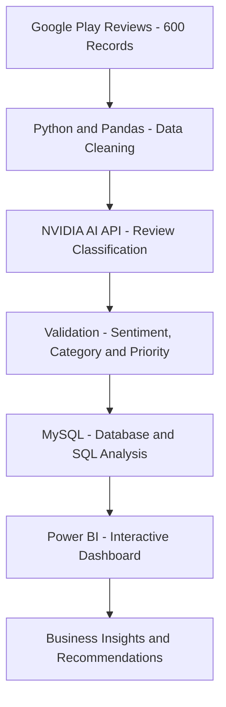

# Myntra Customer Complaint Intelligence

An AI-powered customer review analysis project that uses Python, NVIDIA AI, MySQL, and Power BI to identify customer complaints, analyse sentiment, classify issues, and generate actionable business insights.

## Project Overview

This project analyses 600 customer reviews of the Myntra shopping application collected from Google Play.

The objective is to transform unstructured customer feedback into meaningful insights that help identify customer pain points and improve customer experience.

## Tech Stack

- **Python:** Data cleaning, preprocessing and automation
- **Pandas:** Data manipulation and analysis
- **NVIDIA API:** AI-powered review classification
- **MySQL 8.0:** Database management and SQL analysis
- **Power BI:** Interactive dashboard and visualisation
- **VS Code:** Development environment

## Project Workflow

1. Collected customer reviews from Google Play.
2. Cleaned and prepared the review dataset using Python.
3. Integrated NVIDIA API for AI-powered classification.
4. Classified reviews based on sentiment, category and priority.
5. Validated AI-generated classifications.
6. Imported 600 records into MySQL.
7. Performed SQL analysis to identify customer complaint patterns.
8. Created an interactive Power BI dashboard.

   
## Project Architecture




## Dataset Overview

- Total Reviews: 600
- Positive Reviews: 476
- Negative Reviews: 104
- Neutral Reviews: 20
- Total Complaints: 108
- Average Rating: 4.25 / 5

## Complaint Category Analysis

| Category | Complaints |
|---|---:|
| Customer Support | 35 |
| Delivery | 31 |
| Return/Exchange | 14 |
| Product Quality | 9 |
| Refund | 7 |
| Other | 6 |
| Pricing | 3 |
| App/Technical Issue | 3 |

## Key Business Insights

1. Customer Support is the largest complaint category, accounting for 32.41% of complaints.
2. Delivery issues contribute 28.70% of complaints.
3. Customer Support and Delivery together account for 61.11% of all complaints.
4. Despite an average rating of 4.25, approximately 18% of reviews are classified as complaints.

## SQL Analysis

SQL queries were developed to analyse:

- Overall complaint statistics
- Complaint distribution by category
- Priority analysis
- Sentiment distribution
- Rating analysis
- High-priority complaints
- Monthly complaint trends
- Recent customer complaints

## Power BI Dashboard

The interactive dashboard presents customer feedback through KPIs, sentiment distribution, complaint categories and priority analysis.

**Dashboard Screenshot:**


## Project Structure

```text
Myntra-Customer-Complaint-Intelligence/
│
├── ai_service.py
├── classify_reviews.py
├── cleaned_reviews.csv
├── classified_reviews.csv
├── validated_reviews.csv
├── powerbi_reviews.csv
├── mysql_reviews.csv
├── myntra_complaint_analysis.sql
├── README.md
└── .gitignore
```

## Learning Outcomes

- Practical experience with Python and Pandas.
- Working with AI APIs for text classification.
- SQL querying and business data analysis.
- Power BI dashboard development.
- Converting unstructured customer feedback into business insights.

## Conclusion

This project demonstrates how AI, Python, SQL and Power BI can work together to analyse customer feedback, identify recurring complaints and support data-driven business decisions.

**Project Type:** Data Analytics | AI-Powered Text Classification | Business Intelligence
